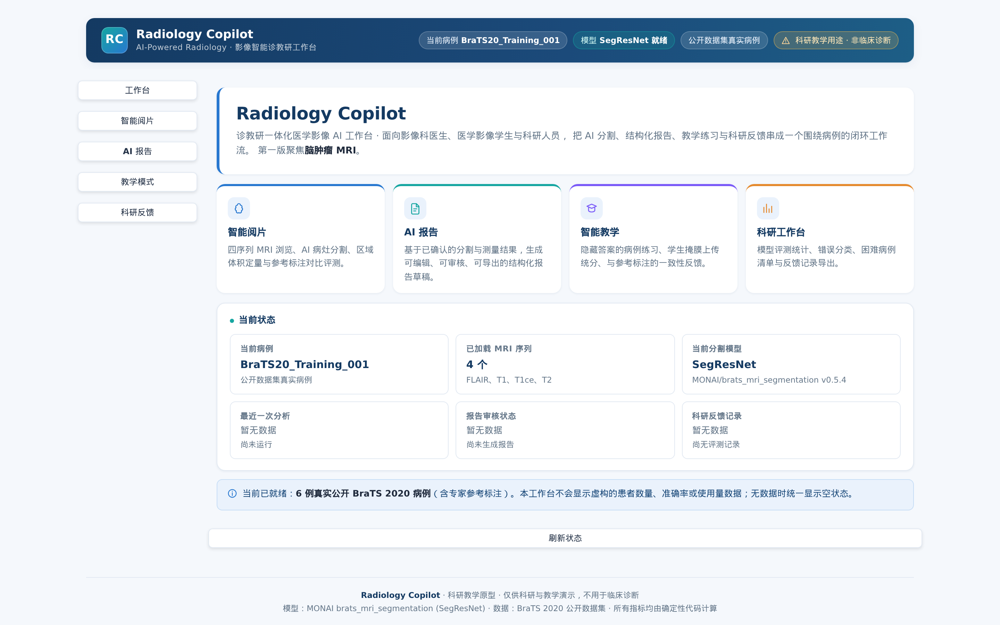
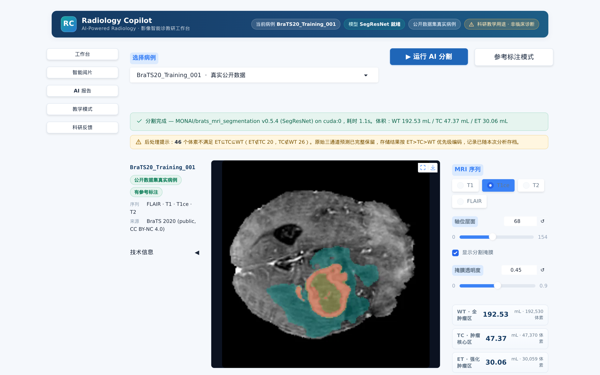
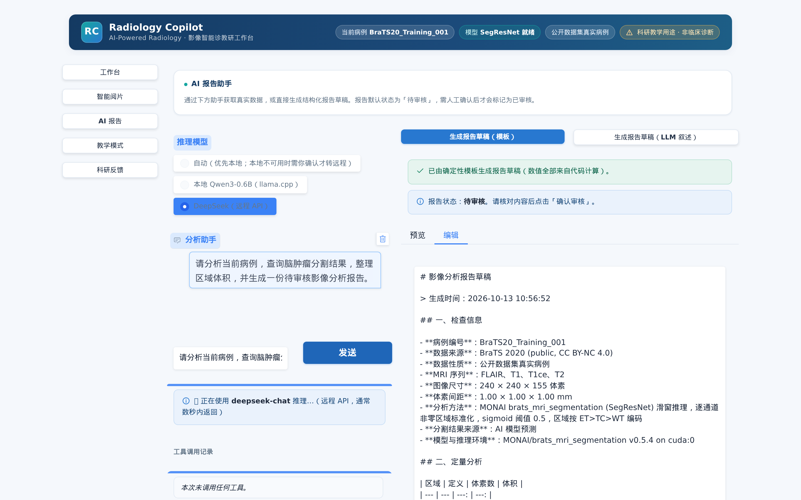
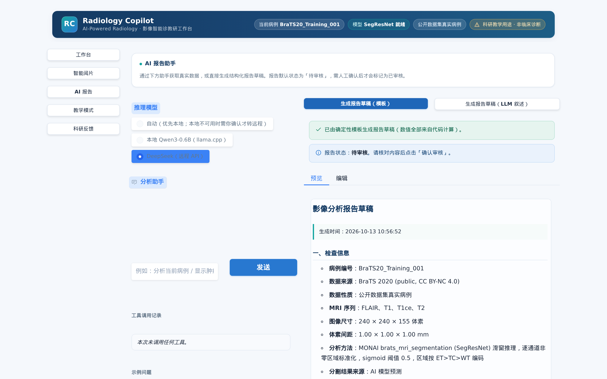
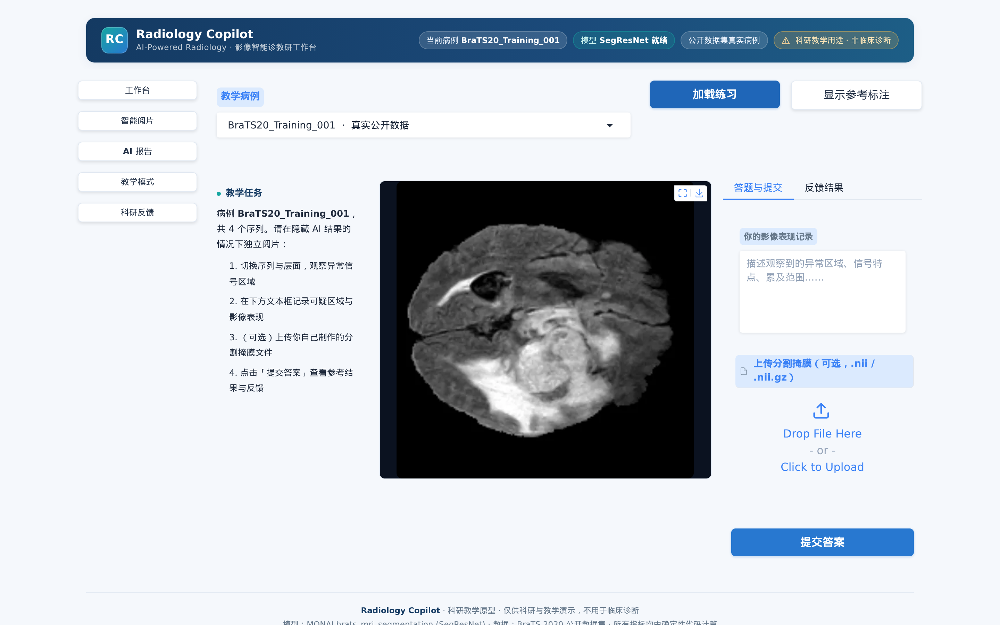
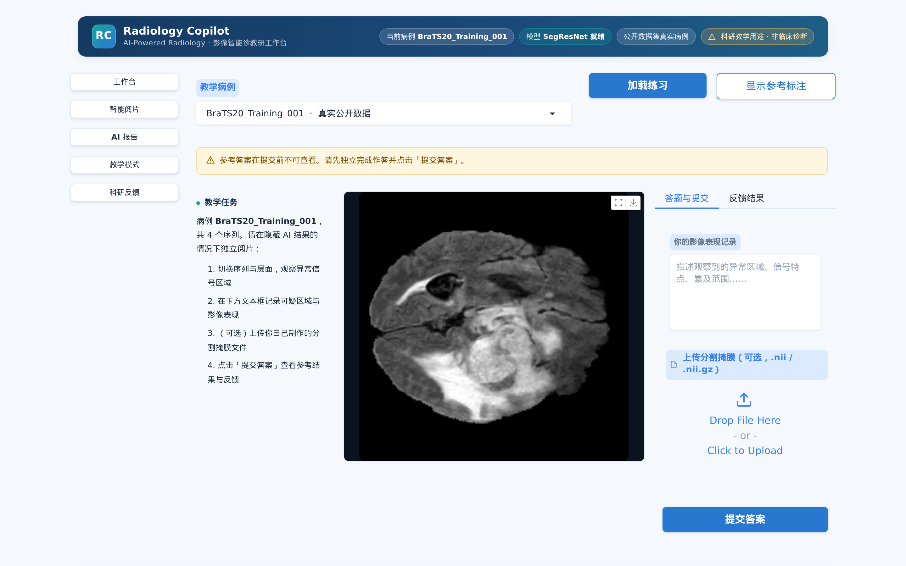
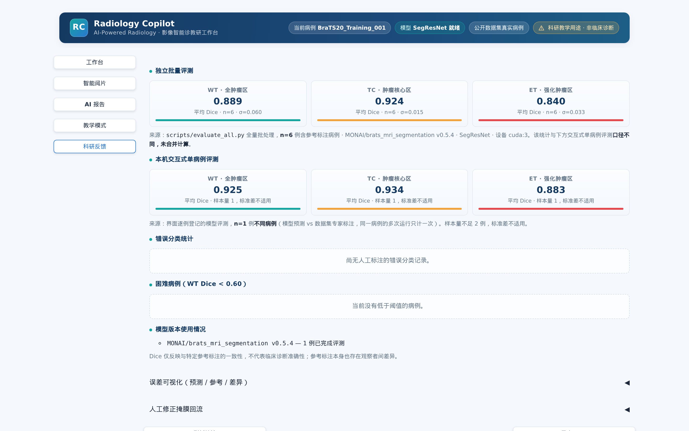
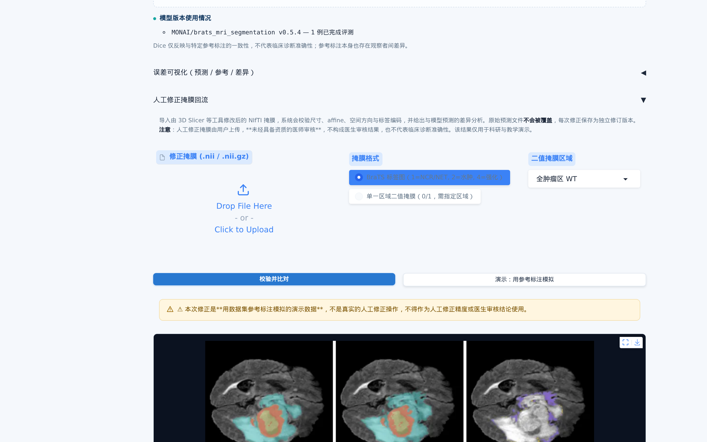

# Radiology Copilot · 影像智能诊教研工作台

> **一个把「AI 分割 → 结构化报告 → 教学练习 → 科研反馈」串成闭环的脑肿瘤 MRI 工作台。**
> 真实公开数据、真实分割模型、真实 LLM 工具调用，所有数值可复现、所有来源可追溯。
>
> ⚠️ **科研与教学原型，非临床诊断系统。** 未经临床验证，不得用于任何临床决策。

<p align="center">
  
</p>


---

## 目录

1. [为什么做这个产品](#1-为什么做这个产品)
2. [目标用户与实际场景](#2-目标用户与实际场景)
3. [诊—教—研工作流](#3-诊教研工作流)
4. [真实 AI 分割与 Agent 工具调用](#4-真实-ai-分割与-agent-工具调用)
5. [产品界面](#5-产品界面)
6. [技术架构](#6-技术架构)
7. [安装与运行](#7-安装与运行)
8. [数据来源、模型版本与许可证](#8-数据来源模型版本与许可证)
9. [测试结果](#9-测试结果)
10. [产品限制](#10-产品限制)

---

## 1. 为什么做这个产品

影像科的三件事——**辅助诊断、教学、科研**——今天由三套互不相通的工具承担，
同一个病例的状态在它们之间必然失真：

- **医生**逐层勾画肿瘤边界耗时，体积测量重复且易错，AI 工具与报告系统割裂；
- **学生**缺少"隐藏答案 → 独立判断 → 与专家标注逐体素对比"的量化练习闭环；
- **科研人员**想知道模型**在哪些病例上失败、失败成什么样**，只能翻日志靠印象。

而通用大模型虽然能"聊"影像，却不能替代经过验证的分割模型，
更不能仅凭一张掩膜推断病理类型——那属于编造。

**本项目要做的是**：把三者收敛到**同一个 `Case` 对象**上，
并且把"AI 能做什么、不能做什么"用工程手段固化下来，而不是写在免责声明里。

## 2. 目标用户与实际场景

| 用户 | 场景 | 系统提供 |
| --- | --- | --- |
| **影像科医生** | 读片时快速获得分割与体积 | 四序列浏览、AI 分割叠加、WT/TC/ET 定量、可编辑报告草稿 |
| **医学影像学生 / 规培医师** | 用真实病例做量化阅片练习 | 提交前隐藏答案的练习、掩膜上传客观评分、结构化核对清单 |
| **医学影像 AI 科研人员** | 定位模型失败模式 | Dice 统计、错误分类、困难病例清单、人工修正回流、CSV 导出 |

## 3. 诊—教—研工作流

```
                    ┌─────────────────────────────────────────┐
                    │        同一个 Case 对象贯穿全流程         │
                    └─────────────────────────────────────────┘
                                      │
   ①选择病例 ──→ ②输入检查 ──→ ③AI 分割 ──→ ④确定性定量
                    │(不通过则阻止)      │            │
                    │                    ▼            ▼
                    │            ⑤与参考标注比对 Dice  ⑥区域体积 mL
                    │                    │            │
                    │                    └─────┬──────┘
                    │                          ▼
                    │                  ⑦LLM Agent 工具调用
                    │                          │
                    │                          ▼
                    │                  ⑧报告草稿（待审核）
                    │                          │
                    │                          ▼
                    │                  ⑨人工确认审核 ──→ 导出 MD / JSON
                    │                          │
                    ▼                          ▼
            ⑩教学练习（答案提交前隐藏）   ⑪人工修正掩膜回流
                    │                          │
                    ▼                          ▼
            ⑫客观评分反馈            ⑬科研反馈沉淀 ──→ ⑭Dashboard / CSV
                                                  │
                                                  ▼
                                       下一轮模型改进的研究任务
```

**闭环的关键**：同一份病例在四个环节之间流转时，影像、掩膜、测量值、审核状态
始终指向同一条记录，不存在"教学用的是另一个病例"这类错位。

## 4. 真实 AI 分割与 Agent 工具调用

### 4.1 AI 分割（真实模型，非演示数据）

| 项目 | 值 |
| --- | --- |
| 模型 | MONAI Model Zoo `MONAI/brats_mri_segmentation` bundle v0.5.4 |
| 架构 | **SegResNet**（`blocks_down=[1,2,2,4]`, `init_filters=16`, in=4, out=3） |
| 输入通道 | `T1c → T1 → T2 → FLAIR`（依据 bundle 自身元数据，非猜测） |
| 输出区域 | `ch0=TC, ch1=WT, ch2=ET` —— 注意 **WT 是通道 1 而非 0** |
| 推理 | `SlidingWindowInferer(roi=[240,240,160], overlap=0.5)` |

**在 6 例公开 BraTS 2020 病例上的实测精度**（模型预测 vs 专家参考标注）：

| 区域 | 平均 Dice | 标准差 |
| --- | ---: | ---: |
| WT 全肿瘤区 | **0.8889** | 0.0604 |
| TC 肿瘤核心区 | **0.9243** | 0.0155 |
| ET 强化肿瘤区 | **0.8400** | 0.0327 |

> ⚠️ **样本量仅 6 例，属小样本实验结果，不代表模型的泛化性能。**
> 完整记录见 [docs/EVALUATION.md](docs/EVALUATION.md)。

### 4.2 LLM Agent（真实 Function Calling）

Agent 的职责被刻意限定为**选工具、排顺序、把结构化结果组织成回答**。
影像分析交给分割模型，数值计算交给确定性代码。

**真实执行记录**（DeepSeek `deepseek-chat`，2026-10-12）：

```
提问：请分析当前病例，查询脑肿瘤分割结果，整理区域体积，并生成一份待审核影像分析报告。

执行模式 : llm_tool_calling          ← 真实 LLM 决策
模型调用 : 3 次 API 往返
工具调用 : 6 次
  1. [ok] get_case_info              0 ms   病例 BraTS20_Training_001
  2. [ok] validate_mri               0 ms   输入检查通过
  3. [ok] get_segmentation_results   8 ms   MONAI/brats_mri_segmentation v0.5.4
  4. [ok] calculate_volume           4 ms   WT 192.53 / TC 47.37 / ET 30.06 mL
  5. [ok] get_review_status          0 ms   审核状态: unreviewed
  6. [ok] generate_report_draft    313 ms   已生成待审核报告草稿（1062 字符）
耗时     : 模型 4.42s / 工具 0.32s / 总计 4.74s
一致性校验: 通过（体积与病例编号与工具返回值全部一致）
```

**LLM 报告叙述**同样完成真实验证：输入 579 / 输出 264 / 合计 **843 tokens**，
生成叙述经一致性校验通过，报告状态保持 `pending_review`。

### 4.3 三种模式严格区分，绝不混淆

| 模式 | 触发条件 | 界面标识 |
| --- | --- | --- |
| **LLM 工具调用模式** | 配置 API 且通过函数调用探测 | 「LLM 工具调用模式（真实函数调用）」 |
| **固定工作流模式** | 未配置 API 或探测失败 | 「固定工作流模式（未经 LLM 决策）」 |
| **报告模板生成** | 点击模板按钮 | 「已由确定性模板生成」 |

### 4.4 本地小模型（Qwen3-0.6B）

除远程 DeepSeek 外，项目支持用**本地 Qwen3-0.6B**（4-bit，462 MB）完成同样的
Agent 工作。界面「AI 报告」页的**推理模型**选择器可在
`DeepSeek / 本地 Qwen3-0.6B / 自动` 之间切换，工具注册、参数校验、
人工确认与安全机制完全不变。

**默认是 DeepSeek**：交互式演示无法承受本地 CPU 推理每轮 100–425 秒的等待。

**不做静默外部回退**：本地服务不可用时，系统**不会**自动改用 DeepSeek。
把病例结构化数据发往第三方服务，与在本机跑模型是两件不同的事，
必须由用户明确选择。选择「自动」且本地不可用 → 拒绝执行并说明原因；
明确选择 DeepSeek → 视为用户确认。一旦回退，界面会标注 `⚠ 已回退：<原因>`。

```bash
python scripts/fetch_local_model.py     # 下载 4-bit GGUF（约 462 MB）
python scripts/local_llm_server.py      # 启动本地 OpenAI 兼容服务（仅本机）
```

| 项目 | 值 |
| --- | --- |
| 模型 | `Qwen3-0.6B-Q4_K_M.gguf`（4-bit 量化） |
| 运行时 | llama.cpp（`llama-cpp-python`），**纯 CPU 推理** |
| 接口 | `http://127.0.0.1:8080/v1`（OpenAI 兼容，仅回环） |
| 显存占用 | **0 MB**（不占用本机 GPU） |
| 内存占用 | 峰值约 5.3 GB RSS |

> **为什么是 llama.cpp 而不是 Ollama**：本机无法访问 GitHub release 资源，
> Ollama 官方二进制只在该处分发，无法在不打扰共享环境的前提下安装。
> `llama-cpp-python` 通过 PyPI 安装，是同样轻量、同样提供 OpenAI 兼容
> `/v1/chat/completions` 的替代方案，且以普通用户进程运行，无需守护进程与 root。

#### 真机对比

| provider | 模型 | 工具选择 | 任务完成 | 参数格式 | 体积一致 | 病例编号一致 | 平均耗时 |
| --- | --- | :---: | :---: | :---: | :---: | :---: | ---: |
| 本地 | `qwen3-0.6b` | 3/3 | 3/3 | 3/3 | 3/3 | 3/3 | 207.8 s |
| 远程 | `deepseek-chat` | 3/3 | 3/3 | 3/3 | 3/3 | 3/3 | **4.7 s** |

**0.6B 在正确性上与 DeepSeek 持平，差距只在速度（约 44×）。**

> ⚠️ 仅 3 个任务、1 个病例、1 次运行，**不能据此得出泛化性结论**。
> 完整数据、观察到的差异与未验证事项见
> **[docs/MODEL_COMPARISON.md](docs/MODEL_COMPARISON.md)**。

服务端不会把 Qwen3 的 `<tool_call>` 文本解析成结构化字段，因此项目内有一个
**传输层适配器**把该格式翻译成标准工具调用。它只做格式转换：选哪个工具、
传什么参数仍由模型决定，解析结果照样经过 JSON Schema 校验与工具注册表——
**适配器不是绕过校验的通道**（有测试专门断言这一点）。

复现：

```bash
python scripts/local_llm_server.py &
python scripts/compare_llm_providers.py --providers local deepseek
```

### 4.5 Agent 安全边界

- **参数校验**：模型返回的每个参数按 JSON Schema 校验（类型/必需项/未声明属性/枚举），
  不合法直接返回 `error` 并把原因回灌给模型，不会拼进 Python 调用
- **不可自行改变状态**：`run_segmentation` 即使模型传 `confirm=true` 也返回 `refused`
- **不可审批报告**：`generate_report_draft` 只写 `pending_review` 修订
- **无危险工具**：注册表中不存在 shell / 文件读写 / 删除类工具
- **回答一致性校验**：回答中的每个体积与病例编号都会与工具**真实返回值**比对，
  不符时在回答旁标注，**不以模型的说法覆盖工具结果**
- **只发送结构化数据**：不含原始影像、文件系统路径或患者信息

## 5. 产品界面

| 工作台 | 智能阅片 · AI 分割 |
| --- | --- |
|  |  |

| Agent 工具调用（真实执行记录） | 报告预览（Markdown 渲染） |
| --- | --- |
|  |  |

| 教学 · 答案提交前隐藏 | 教学 · **提交前查看答案被拒绝** |
| --- | --- |
|  |  |

| 科研 Dashboard（两类评测分开统计） | 人工修正掩膜 · 差异分析 |
| --- | --- |
|  |  |

其余截图见 [assets/screenshots/](assets/screenshots/)：
参考标注模式、报告编辑、教学反馈、误差对比图、修正历史、
[本地 Qwen3-0.6B 工具调用](assets/screenshots/11_local_qwen_agent.png)。

### 🎬 演示视频

| 文件 | 时长 | 内容 |
| --- | --- | --- |
| [`assets/demo/radiology_copilot_demo.mp4`](assets/demo/radiology_copilot_demo.mp4) | **1:33** | 完整流程：工作台 → AI 分割 → LLM 工具调用 → 报告审核 → 教学 → 科研 |
| [`assets/demo/radiology_copilot_correction_clip.mp4`](assets/demo/radiology_copilot_correction_clip.mp4) | 0:28 | 人工修正掩膜回流：校验 → 差异分析 → 保存为科研反馈 |

视频由 [scripts/record_demo.py](scripts/record_demo.py)（主流程）驱动**真实运行的程序**录制，
不是动画或后期合成：其中的分割、LLM 工具调用、报告生成、修正回流都是现场执行的真实结果。

```bash
python app.py &
python scripts/record_demo.py --pace 0.55        # 录制主流程
```

> **为什么修正回流单独录一段**：Gradio 会在手风琴面板折叠时把其子元素移出 DOM，
> 自动化脚本在长流程末尾驱动这个面板不稳定。功能本身经回调级测试与手工操作验证正常，
> 因此单独录一段完整、可靠的片段，而不是在长视频里塞入一段可能点不中的操作。
> 逐句讲解稿见 [docs/DEMO_SCRIPT.md](docs/DEMO_SCRIPT.md)。

## 6. 技术架构

```
┌──────────────────────────────────────────────────────────────────────┐
│                       app.py  (Gradio Blocks)                        │
│    工作台 │ 智能阅片 │ AI 报告 │ 教学模式 │ 科研反馈                    │
└──────┬──────────────┬──────────────┬──────────────┬─────────────────┘
       │              │              │              │
       ▼              ▼              ▼              ▼
 ┌──────────┐  ┌────────────┐  ┌──────────┐  ┌───────────────┐
 │ imaging  │  │segmentation│  │  agent   │  │  teaching     │
 │ 读取/校验│  │MONAI bundle│  │工具注册表│  │  答案隐藏     │
 │ 渲染/裁剪│  │滑窗推理    │  │调用循环  │  │  掩膜评分     │
 └────┬─────┘  └─────┬──────┘  └────┬─────┘  └──────┬────────┘
      │              │              │               │
      │              ▼              ▼               │
      │        ┌───────────┐  ┌──────────┐          │
      │        │  metrics  │  │  report  │          │
      │        │体积/Dice  │  │结构化报告│          │
      │        │标签解码   │  │LLM 叙述  │          │
      │        └─────┬─────┘  └────┬─────┘          │
      │              │             │                │
      │              ▼             ▼                ▼
      │        ┌─────────────────────────────────────────┐
      │        │ corrections  人工修正掩膜回流            │
      │        │ 校验 / 差异 / 版本化（不覆盖预测）        │
      │        └────────────────┬────────────────────────┘
      ▼                         ▼
 ┌──────────────────────────────────────────────────────┐
 │  cases.py 统一 Case 对象   +   storage.py (SQLite)     │
 │  NIfTI 体数据 → 文件系统    ·   结构化记录 → SQLite     │
 └────────────────────────────┬─────────────────────────┘
                              ▼
                    research.py 反馈聚合 / CSV
```

**设计要点**

- **统一 Case 对象**：不存在三套互相不同步的病例状态，页面切换不清除病例状态
- **存储分层**：体数据放文件系统，结构化记录放 SQLite，标量结果随记录保存
- **模型架构不硬编码**：从 bundle 自带的 `configs/inference.json` 读取 `network_def`，
  保证构造出的网络就是权重被训练的那个结构；`load_state_dict(strict=True)` 全量匹配
- **三类掩膜互不覆盖**：数据集参考标注 / 模型预测 / 人工修正分别存储，各自带来源标签
- **报告追加式修订**：审核产生新版本，**不覆盖**原始模型预测

详细说明见 [docs/ARCHITECTURE.md](docs/ARCHITECTURE.md)。

### 自行实现 vs 复用开源组件

| 自行实现 | 复用的开源组件 |
| --- | --- |
| 统一 Case 对象与数据集适配器（模态映射、标签约定声明与校验） | **MONAI**：SegResNet 架构、Bundle 加载、`NormalizeIntensity`、`SlidingWindowInferer`、`AsDiscrete` 等变换 |
| 区域解码、体积计算、Dice、嵌套冲突处理（`metrics.py`） | **PyTorch**：张量运算与推理 |
| 头部裁剪、灰度窗、掩膜叠加渲染（`imaging.py`） | **NiBabel**：NIfTI 读写与 affine 处理 |
| 全部 UI 布局、设计系统与交互（`app.py` / `theme.py`） | **Gradio**：Web 框架与组件 |
| Agent 工具注册表、参数校验、调用循环、一致性校验、降级策略 | **OpenAI Python SDK**：OpenAI 兼容客户端 |
| 教学答案隔离、人工修正回流、科研反馈与统计口径 | **SQLite**（标准库） |
| | **Pillow / NumPy**：图像与数组处理 |

## 7. 安装与运行

### 7.1 环境

```bash
python -m venv .venv && source .venv/bin/activate
# 如需特定 CUDA 版本，先装 torch：
# pip install torch --index-url https://download.pytorch.org/whl/cu124
pip install -r requirements.txt
```

### 7.2 获取模型权重（约 19 MB）

```bash
python scripts/fetch_model.py
python scripts/fetch_model.py --verify     # 确认能加载
```

> 若网络无法访问 HuggingFace，项目会自动回退到镜像，
> 也可手动设置 `HF_ENDPOINT=https://hf-mirror.com`（见 `.env.example`）。

### 7.3 获取公开病例数据

```bash
python scripts/fetch_data.py --cases 6
```

脚本从公开的 BraTS 2020 镜像**只下载所需病例**（利用 ZIP 中央目录做 HTTP Range 请求），
6 例约 480 MB，而非整个 4.5 GB 压缩包。数据写入 `data/`（已被 `.gitignore` 排除）。

### 7.4 启动

```bash
python app.py                 # http://127.0.0.1:7860
```

首次启动约 30–60 秒（需载入首个病例的四序列体数据）。

**远程服务器**：应用默认只监听 `127.0.0.1`，**不会暴露到公网**，用 SSH 端口转发访问：

```bash
ssh -L 7860:127.0.0.1:7860 <user>@<your-server>
```

### 7.5 配置语言模型（可选）

不配置也能完整使用，Agent 会运行在**固定工作流模式**并在界面如实标注。

```bash
cp .env.example .env      # 填入 LLM_API_KEY / LLM_BASE_URL / LLM_MODEL
```

任何 OpenAI 兼容端点均可。启动时会**实际探测**是否支持 function calling。

### 7.6 真实端到端验证

```bash
python scripts/agent_e2e.py --dry-run         # 仅检查配置与函数调用能力
python scripts/agent_e2e.py                   # 真实工具调用，写脱敏记录
python scripts/agent_report_e2e.py            # LLM 报告叙述，含 token 用量
python scripts/evaluate_all.py                # 批量评测，产出 Dice 统计
python scripts/screenshots.py --run-segmentation   # 重新生成界面截图
```

## 8. 数据来源、模型版本与许可证

| 资源 | 版本 / 来源 | 许可证 |
| --- | --- | --- |
| **BraTS 2020 训练数据** | 公开数据集（多模态脑肿瘤 MRI + 专家标注） | **CC BY-NC 4.0（非商业）** |
| **MONAI brats_mri_segmentation** | bundle v0.5.4（SegResNet） | Apache-2.0 |
| MONAI | 1.5.0 | Apache-2.0 |
| PyTorch | 2.6.0 | BSD-3-Clause |
| NiBabel | 5.3.2 | MIT |
| Gradio | 5.38.0 | Apache-2.0 |

- 本项目使用 **BraTS 2020 公开训练集**开展演示验证
- **不重新分发任何影像数据**：`scripts/fetch_data.py` 仅提供获取脚本，
  `data/`、`models/`、`outputs/` 均已加入 `.gitignore`
- 模型权重由脚本下载，不随仓库分发
- API Key 只存于 `.env`（已 gitignore），代码中不硬编码、不打印、不记录

## 9. 测试结果

```bash
$ python -m pytest tests/ -q
311 passed
```

| 测试文件 | 数量 | 覆盖范围 |
| --- | ---: | --- |
| `test_agent_llm.py` | 74 | 工具参数校验、调用失败反馈、API 未配置降级、非法工具名、未授权状态修改、报告数值一致性、trace 真实状态与耗时、跨病例隔离 |
| `test_ux_fixes.py` | 41 | 阅片构图（裁剪/等比/掩膜最近邻）、教学答案隔离、统计口径、误差可视化、跨病例隔离 |
| `test_agent_storage.py` | 35 | 工具三态、持久化、聚合口径、报告修订 |
| `test_report_teaching.py` | 30 | 报告数值一致性、不推断病理、答案隐藏、掩膜评分 |
| `test_corrections.py` | 47 | 修正掩膜导入、空间匹配、版本化、来源标注、跨病例隔离 |
| `test_cases_imaging.py` | 28 | 通道顺序映射、输入校验、几何、渲染 |
| `test_metrics.py` | 27 | 标签约定、区域嵌套、体积、Dice 边界情形 |
| `test_app_callbacks.py` | 29 | 逐个调用全部 UI 回调，捕获回调内的静默错误 |

全部测试**无需数据集与模型权重**即可通过（用临时目录中的小型 NIfTI 构造夹具），
并且与宿主环境的 `.env` 隔离，**不会产生真实 API 调用**。

## 10. 产品限制

**必须明确的边界**

- 🚫 **仅供科研、教学与算法演示，不是临床诊断系统**，未经过任何临床验证
- 🚫 **不做**病理类型、分子分型、WHO 分级、治疗建议的推断——分割模型看不到组织病理，
  生成这类结论即为编造
- 📊 **6 例 Dice 是小样本实验结果**，不代表模型泛化性能；参考标注本身也存在观察者间差异
- ⚠️ **Dice 只反映与特定标注的一致性**，不等于临床诊断准确性
- 👤 **人工修正掩膜为用户上传，未经医师审核**，不构成医生审核结果
- 🧪 演示模式（用参考标注模拟修正）在各处明确标注为演示，不得当作真实人工修正精度

**已知技术限制**

| 限制 | 说明 |
| --- | --- |
| 仅轴位阅片 | 未实现多平面重建与 3D 重建 |
| 无在线掩膜编辑器 | 需借助 3D Slicer 等外部工具修改后上传 |
| 模型未做外部验证 | 仅在 BraTS 2020 同源数据上验证，未做多中心测试 |
| 切换病例约 5 秒 | 同步加载 4 个序列（约 72 MB）并做输入校验 |
| 固定工作流为降级路径 | 未配置 API 时由关键词路由决定工具链，非 LLM 决策（界面会标注） |

---

## 文档索引

| 文档 | 内容 |
| --- | --- |
| [docs/PRODUCT_CASE_STUDY.md](docs/PRODUCT_CASE_STUDY.md) | 产品案例：背景、取舍、迭代记录、效果评估 |
| [docs/DEMO_SCRIPT.md](docs/DEMO_SCRIPT.md) | 90 秒演示稿（AI 产品经理版 / Agent 产品经理版） |
| [docs/AGENT_ARCHITECTURE.md](docs/AGENT_ARCHITECTURE.md) | **Agent 架构**：双模型、工具注册、权限管理、执行追踪 |
| [docs/MODEL_COMPARISON.md](docs/MODEL_COMPARISON.md) | 本地 Qwen3-0.6B vs DeepSeek 真机对比 |
| [docs/ARCHITECTURE.md](docs/ARCHITECTURE.md) | 技术架构、Agent 工具设计、踩坑复盘 |
| [docs/EVALUATION.md](docs/EVALUATION.md) | 真实评测记录、定位并修复的缺陷、未完成事项 |
| [docs/PRD.md](docs/PRD.md) | 产品需求（精简版） |

---

<p align="center">
<strong>Radiology Copilot</strong> · 科研教学原型 · 仅供科研与教学演示，不用于临床诊断
</p>
